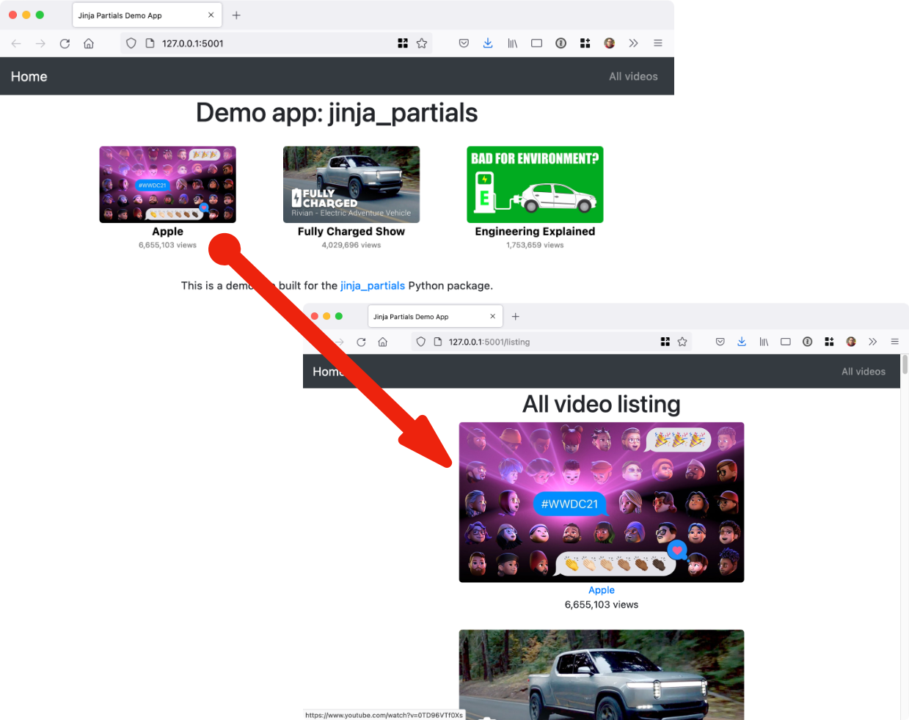

# Chameleon Partials

Simple reuse of partial HTML page templates in the Chameleon template language for Python web frameworks.
(There is also a [Jinja2/Flask version here](https://github.com/mikeckennedy/jinja_partials).)

## Overview

When building real-world web apps with Chameleon, it's easy to end up with repeated HTML fragments.
Just like organizing code for reuse, it would be ideal to reuse smaller sections of HTML template code.
That's what this library is all about.

## Documentation

Full documentation lives at [mkennedy.codes/docs/chameleon-partials](https://mkennedy.codes/docs/chameleon-partials/). The user guide expands each section of this README:

- [Getting started](https://mkennedy.codes/docs/chameleon-partials/user-guide/getting-started.html): install, register the template folder, wire `render_partial` into your framework, render a first fragment.
- [Writing partials](https://mkennedy.codes/docs/chameleon-partials/user-guide/writing-partials.html): how paths resolve, the model, nesting, loops, METAL layouts, rendering from Python, and choosing partials safely.
- [Testing](https://mkennedy.codes/docs/chameleon-partials/user-guide/testing.html): a pytest fixture for the one-time registration and what the error types promise.
- [Troubleshooting](https://mkennedy.codes/docs/chameleon-partials/user-guide/troubleshooting.html): every error you can hit in normal use, its cause, and the fix.
- [API reference](https://mkennedy.codes/docs/chameleon-partials/reference/), generated from the library's docstrings.

Coding agents can read the same material from [llms-full.txt](https://mkennedy.codes/docs/chameleon-partials/llms-full.txt) or install the [agent skill](https://mkennedy.codes/docs/chameleon-partials/skills.html).

## Example

This project comes with a sample Pyramid application (see the `example` folder). This app displays videos
that can be played on YouTube. The image, author subtitle, and view count are reused throughout the
app. Here's a visual:



Check out the [**demo / example application**](https://github.com/mikeckennedy/chameleon_partials/tree/main/example) 
to see it in action. 

## Installation

It's just `pip install chameleon-partials` (or `uv add chameleon-partials`) and you're all set with this pure Python package. It needs Python 3.10 or newer and depends only on Chameleon.

## Usage

Using the library is incredibly easy. The first step is to register the partial method with Chameleon.
Do this once at app startup:

```python
from pathlib import Path

from pyramid.config import Configurator

import chameleon_partials


def main(_, **settings):
    """This function returns a Pyramid WSGI application."""
    with Configurator(settings=settings) as config:
        config.include('pyramid_chameleon')
        config.include('.routes')
        config.scan()

        # Register the extension for working with Chameleon.
        folder = (Path(__file__).parent / 'templates').as_posix()
        chameleon_partials.register_extensions(folder, auto_reload=True, cache_init=True)

    return config.make_wsgi_app()
```

Set `auto_reload=True` while developing so template edits show up without a restart, and leave it at the default `False` in production. Calling `register_extensions` again after it has succeeded does nothing, so repeated startup calls are safe (see [Testing](https://mkennedy.codes/docs/chameleon-partials/user-guide/testing.html) for pointing tests at their own folder).

Next, you define your main HTML (Chameleon) templates as usual. Then 
define your partial templates. I recommend locating and naming them accordingly:

```
├── templates
│   ├── errors
│   │   └── 404.pt
│   ├── home
│   │   ├── index.pt
│   │   └── listing.pt
│   └── shared
│       ├── _layout.pt
│       └── partials
│           ├── video_image.pt
│           └── video_square.pt
```

Notice the `partials` subfolder in the `templates/shared` folder.

The templates are just HTML fragments. Here is a stand-alone one for the YouTube thumbnail from
the example app:

```html

```

Notice that an object called `video` and a list of classes are passed in as the model.

Templates can also be nested. Here is the whole single video fragment with the image as well as other info
linking out to YouTube:

```html
<div>
    <a href="https://www.youtube.com/watch?v=${ video.id }" target="_blank">
        ${ render_partial('shared/partials/video_image.pt', video=video, classes=[]) }
    </a>
    <a href="https://www.youtube.com/watch?v=${ video.id }" target="_blank"
       class="author">${ video.author }</a>
    <div class="views">${ "{:,}".format(video.views) } views</div>
</div>
```

Now you see the `render_partial()` method. It takes the subpath into the templates folder and
any model data passed in as keyword arguments. The path is always relative to the registered
folder, even when the call is inside another partial. It returns an `HTML` object that Chameleon
inserts unescaped; read its `html_text` attribute when you need the string, for example in a
test or an HTMX response.

We can finally generate the list of video blocks as follows:

```html
<span class="video" tal:repeat="v videos">
    ${ render_partial('shared/partials/video_square.pt', video=v) }
</span>
```

This time, we reframe each item in the list from the outer template (called `v`) as the `video` model
in the inner HTML section.

## Choosing Partials Safely

Choose the partial in your code, never from request data. `render_partial()` refuses a name that would reach outside the registered template folder (an absolute path, a `..` out of the folder, or a `package:path` spec), but a request that picks the fragment should still be mapped to a name you wrote rather than used to build the path:

```python
PARTIALS = {'card': 'shared/partials/video_square.pt', 'row': 'shared/partials/video_row.pt'}
html = render_partial(PARTIALS[request.params['style']], video=video)
```

Pass the model as named keyword arguments too. Spreading a request's parameters into it (`render_partial(name, **request.params)`) lets a parameter replace a name the template relies on, including `render_partial` itself.

## The View Methods

In order to share the `render_partial()` function with your template, you'll need to pass it along to the
template with your model (dictionary). 

If you are using the **Pyramid web framework**, you can add this file as middleware. Just drop it into
your `views` folder:

```python
# views/partials_middleware.py
from pyramid.events import subscriber, BeforeRender

import chameleon_partials


@subscriber(BeforeRender)
def add_global(event):
    event['render_partial'] = chameleon_partials.render_partial
```

For other frameworks using Chameleon (e.g. FastAPI), you can add `render_partial` to the
resulting dictionary. We've built a simple function to keep this fool-proof: 

```python
chameleon_partials.extend_model(model)
```

Here's a typical view method that uses `render_partial`, notice the use of extending the 
model before passing it to the template (the example app's views skip this because the 
middleware above handles it):

```python
@view_config(route_name='listing', renderer='demo_chameleon_partials:templates/home/listing.pt')
def listing(_):
    videos = video_service.all_videos()
    model = dict(videos=videos)
    return chameleon_partials.extend_model(model)
```

Again: If you are using Pyramid, use the middleware. Otherwise, use the `extend_model()` method or something 
similar to the middleware in your framework.

## Testing

Partials are plain functions over plain files, so tests need no web framework. Register the test
template folder in a fixture and reset the registration flag afterwards, because a second
`register_extensions()` call is a no-op by default:

```python
@pytest.fixture
def registered_extension():
    folder = (Path(__file__).parent / 'test_templates').as_posix()
    chameleon_partials.register_extensions(folder, auto_reload=True)
    yield
    chameleon_partials.has_registered_extensions = False


def test_render_with_data(registered_extension):
    html = chameleon_partials.render_partial('render/with_data.pt', name='Sarah', age=32)
    assert '<span>Your name is Sarah and age is 32</span>' in html.html_text
```

The [Testing](https://mkennedy.codes/docs/chameleon-partials/user-guide/testing.html) page covers the error contract: `PartialsException` is raised for misuse only, and Chameleon's own errors (such as the `ValueError` for a missing template) pass through unchanged.

## Troubleshooting

Every error you can hit in normal use, with its cause and fix, is on the [Troubleshooting](https://mkennedy.codes/docs/chameleon-partials/user-guide/troubleshooting.html) page: rendering before registration, `Template not found`, `NameError: render_partial`, markup that shows up escaped, and template edits that do not appear.
